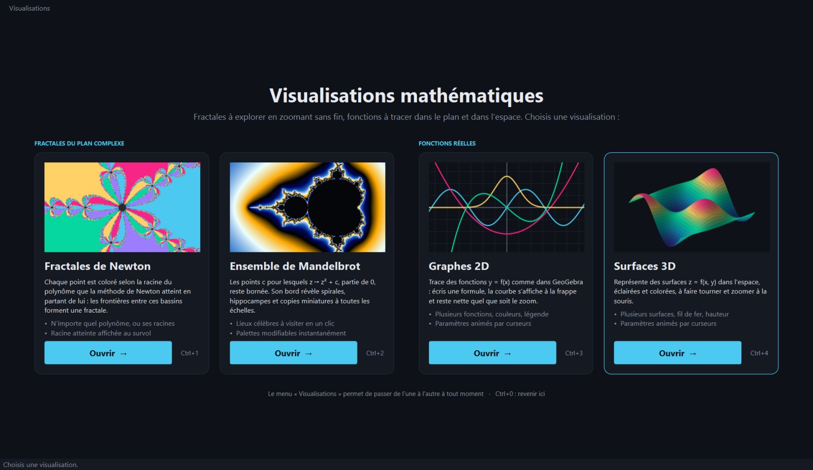
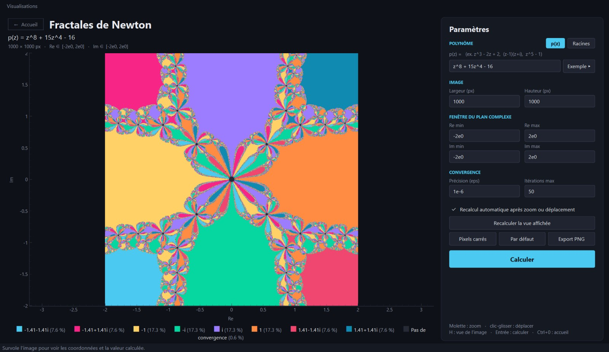
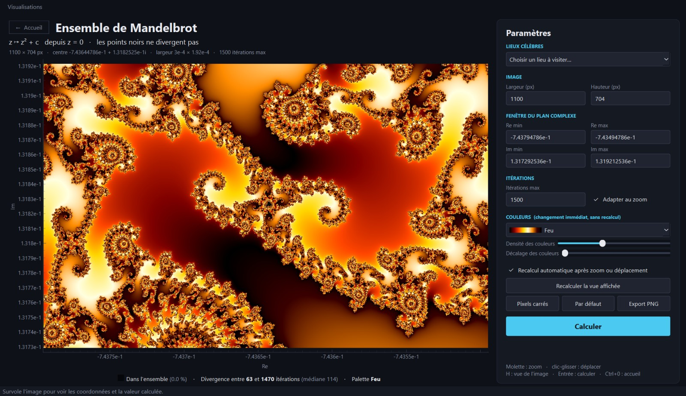
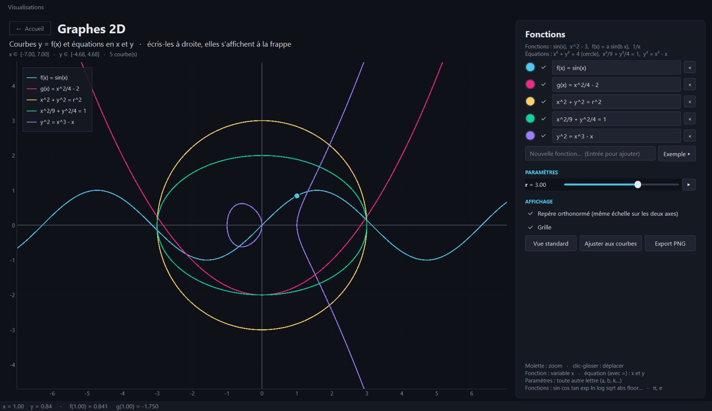
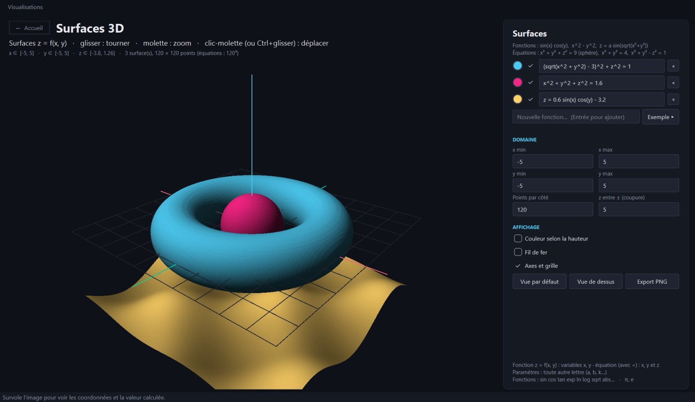
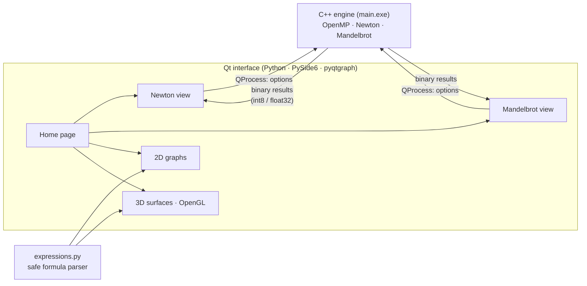

<div align="center">

# Newton Fractals

**Interactive mathematical visualizations — a multithreaded C++ engine and a Qt interface**

Explore Newton fractals and the Mandelbrot set with infinite zoom, and plot functions,
curves and surfaces in 2D and 3D, the way GeoGebra does.

[](https://github.com/ElliotGalaor/Newton_Fractals/actions/workflows/ci.yml)
[](https://github.com/ElliotGalaor/Newton_Fractals/releases/latest)




</div>

## Gallery

<table>
  <tr>
    <td width="50%"><br>
      <b>Newton fractals</b> — basins of attraction of Newton's method for any polynomial
      (here z⁸ + 15z⁴ − 16), typed as a formula or given by its roots.</td>
    <td width="50%"><br>
      <b>Mandelbrot set</b> — Seahorse Valley at ×12 000, smooth colouring, famous places in
      one click, zoom down to 10⁻¹³.</td>
  </tr>
  <tr>
    <td width="50%"><br>
      <b>2D graphs</b> — functions and implicit equations (circle of radius <i>r</i>, ellipse,
      elliptic curve) drawn as you type, with animated parameters.</td>
    <td width="50%"><br>
      <b>3D surfaces</b> — z = f(x, y) and implicit surfaces (torus, sphere) extracted with
      marching cubes, lit and rotated with the mouse.</td>
  </tr>
</table>

## Technical highlights

| | |
|---|---|
| **High-performance C++** | OpenMP multithreading, flat memory layout, Horner evaluation of p and p′ in one pass, early bailout for the Mandelbrot cardioid — a 1000 × 1000 Newton image in ~25 ms, the full Mandelbrot view in ~12 ms. |
| **Numerical methods** | Newton's method on arbitrary complex polynomials, robust grouping of multiple roots, smooth (continuous) escape-time colouring. |
| **Floating-point precision** | Deep zoom down to 10⁻¹³: the view works in recentred coordinates so Qt never loses precision, bounds are written with exactly the digits needed so the view never drifts. |
| **Computational geometry** | Implicit curves with vectorised *marching squares* (pole rejection, saddle cells) and implicit surfaces with *marching cubes*. |
| **Safe expression parser** | Formulas like `2x sin(x)`, `x² + y² = r²` are parsed into a whitelisted syntax tree and evaluated with numpy — user input is never executed as code. |
| **Responsive desktop UI** | Qt (PySide6 + pyqtgraph + OpenGL): computation in a background process, automatic recompute after zoom, throttled slider animation, state saved between sessions. |
| **Engineering practices** | 100+ automated tests, CI building with three compilers (GCC, MinGW, MSVC), lint, automatic Windows release, issue / pull-request workflow. |

## Architecture



The fractal views send their parameters to the C++ engine, which writes a compact binary
grid read back in under a millisecond; the 2D and 3D views evaluate formulas directly
with numpy.

## Quick start

**Ready-to-use Windows build** — download the archive from the
[latest release](https://github.com/ElliotGalaor/Newton_Fractals/releases/latest), then:

```bash
python -m pip install -r requirements.txt
python NewtonFractalsDrawing.py        # or double-click main.exe
```

**From source** (Linux or Windows with g++, or Visual Studio with `NewtonFractals.sln`):

```bash
cd ConsoleApplication2
g++ -O2 -fopenmp -o main main.cpp Tableau.cpp CNum.cpp
python -m pip install -r ../requirements.txt
python NewtonFractalsDrawing.py
```

The window opens on the home page; `Ctrl+1` … `Ctrl+4` open the four visualizations and
`Ctrl+0` brings you back.

## Quality and workflow

- **Tests** — `python -m pytest`: formula parser (including the rejection of any code
  injection), polynomial roots, number formatting, binary formats, integration tests of the
  C++ engine on known results, and smoke tests of the Qt interface running off-screen.
- **Continuous integration** — every push and pull request: `ruff` lint; Linux build
  with `-Wall -Wextra` and the full test suite on Python 3.11 and 3.13; Windows builds
  with MinGW (DLLs bundled next to the executable) and with MSBuild (Visual Studio solution).
- **Continuous delivery** — pushing a `vX.Y.Z` tag builds, tests and publishes a
  Windows archive as a GitHub Release, with release notes generated from merged PRs.
- **Team workflow** — work is tracked in issues and delivered through reviewed pull
  requests; see [CONTRIBUTING.md](CONTRIBUTING.md).

## Documentation

The [user guide](docs/GUIDE.md) covers everything else: all controls, the formula and
polynomial syntax, the engine's command-line options, the binary output formats and the
known limits.

## Project structure

```
ConsoleApplication2/
  main.cpp, CNum.*, Tableau.*   C++ engine (Newton, Mandelbrot, command line, binary output)
  NewtonFractalsDrawing.py      entry point: main window and navigation
  accueil.py                    home page
  vue_*.py                      the four visualization pages
  interface_commune.py          theme and shared base class of the fractal pages
  widgets_fonctions.py          function list and parameter sliders (2D / 3D)
  expressions.py                safe formula parser, marching squares
  newton_calcul.py, mandelbrot_calcul.py   logic without UI
tests/                          pytest suite
.github/workflows/              CI and release pipelines
docs/                           user guide and screenshots
NewtonFractals.sln              Visual Studio solution
```

## Author

[**@ElliotGalaor**](https://github.com/ElliotGalaor)
